---

### Sobre

Estudante de Engenharia de Software na PUC-Campinas e desenvolvedor full stack independente. Atendo clientes enquanto curso a graduação, o que me faz passar por todas as etapas de um projeto: entender o problema, desenhar a arquitetura, implementar e colocar em produção.

No mobile trabalho com **Flutter e Firebase**. Na web, com **Next.js e TypeScript**. Na faculdade venho consolidando a base: orientação a objetos em Java, bancos relacionais e NoSQL, arquitetura de computadores e padrões de projeto.

**Objetivo:** atuar como engenheiro de software full stack, com foco em arquitetura de sistemas escaláveis e em produtos que resolvem problemas reais.

---

### Projetos Integradores

| | Projeto | O que é | Stack | Status |
| :---: | :--- | :--- | :--- | :---: |
| **PI IV** | [**AlugaMáquina**](https://github.com/lucaxaviers/PI_IV-TIME-31) | Plataforma de locação e gestão de máquinas e equipamentos para agronegócio, construção civil e indústria. Arquitetura cliente-servidor em Java, persistência em MongoDB e testes unitários com JUnit | Java · MongoDB · JUnit | 🔴 em andamento |
| **Extra** | [**Acompanhamento de Demandas**](https://github.com/rafaelmvalente/PI-II-TIME-15) | Gestão de tarefas, bugs e melhorias por projeto, com responsáveis, prazos, comentários e histórico | TypeScript · Express | 🔴 em andamento |
| **PI III** | [**MesclaInvest**](https://github.com/mateusor/MesclaInvest) | App de negociação P2P de tokens de startups, com carteira digital em tempo real, dashboard e regras de negócio em Cloud Functions | Flutter · Firebase | ✔️ concluído |
| **PI II** | [**NotaDez**](https://github.com/mateusor/NotaDez) | Sistema de gestão acadêmica para professores: turmas, importação de alunos por CSV/JSON, fórmulas de nota configuráveis e auditoria | Web | ✔️ concluído |
| **PI I** | [**Sustentabilidade**](https://github.com/mateusor/Primeiro-Semestre-ENG-de-Software/tree/main/ProjetoIntegrador) | Registro diário de práticas sustentáveis (água, energia, resíduos e transporte), com cálculo de índices e dados criptografados | Python · MySQL | ✔️ concluído |

O projeto **Extra** é desenvolvido em paralelo ao PI IV, sem valer nota.

---

### Stack

| Área | Tecnologias |
| :--- | :--- |
| **Mobile** |  |
| **Web** |  |
| **Back-end** |  |
| **Linguagens** |  &nbsp;  |
| **Banco de dados** |  &nbsp;  |
| **Qualidade e ferramentas** |  &nbsp;  |

---

### Trajetória acadêmica

Cada semestre tem um repositório próprio, organizado por disciplina.

| Semestre | Destaques | Repositório |
| :---: | :--- | :---: |
| 1º | Algoritmos em Python · Banco de Dados (SQL) · Arduino e ESP32 | [Primeiro Semestre](https://github.com/mateusor/Primeiro-Semestre-ENG-de-Software) |
| 2º | — | [Segundo Semestre](https://github.com/mateusor/Segundo-Semestre-ENG-de-Software) |
| 3º | — | [Terceiro Semestre](https://github.com/mateusor/Terceiro-Semestre-ENG-de-Software) |
| 4º | POO em Java · Banco de Dados II (MongoDB) · Tecnologias para Web | [Quarto Semestre](https://github.com/mateusor/Quarto-Semestre-ENG-de-Software) |

**Em estudo agora:** Java e POO · MongoDB e Oracle · Assembly MIPS · arquitetura de software e design patterns · Flutter avançado

---

### Atividade

  
  
    
  <picture>
    <source media="(prefers-color-scheme: dark)" srcset="https://raw.githubusercontent.com/mateusor/mateusor/output/github-contribution-grid-snake-dark.svg">
    
  </picture>

---

  Tem um projeto ou uma vaga em mente? Me chama no <a href="https://www.linkedin.com/in/mateus-oliveira-223868364/">LinkedIn</a> ou por <a href="mailto:mateus.eletrocastelo@gmail.com">e-mail</a>.

